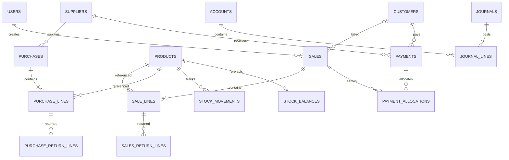

# Proposed relationships

Conceptual only; allocation also covers supplier purchase obligations, opening balances and reversals. Actual cardinality and polymorphic reference integrity require concrete schema design; this diagram is not executable DDL.
